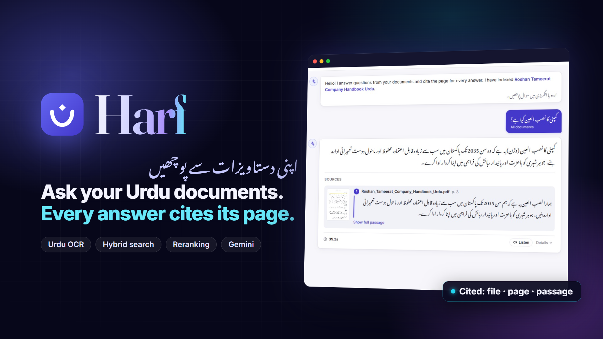
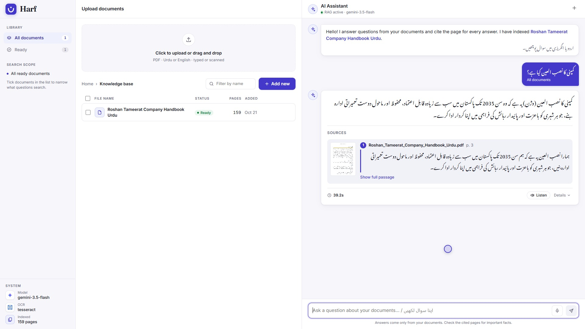
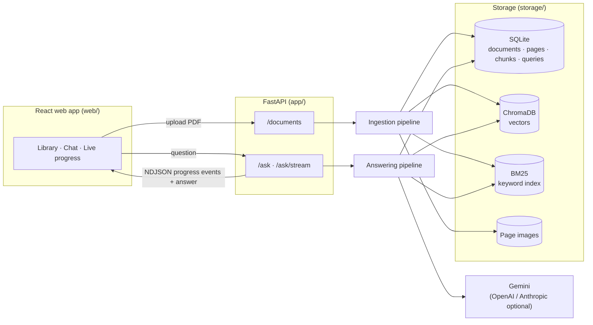
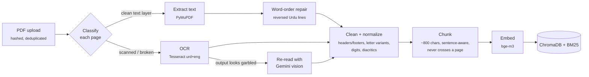
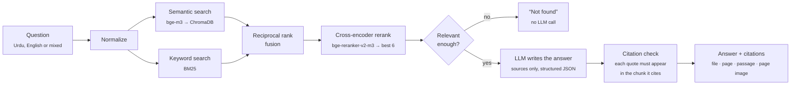
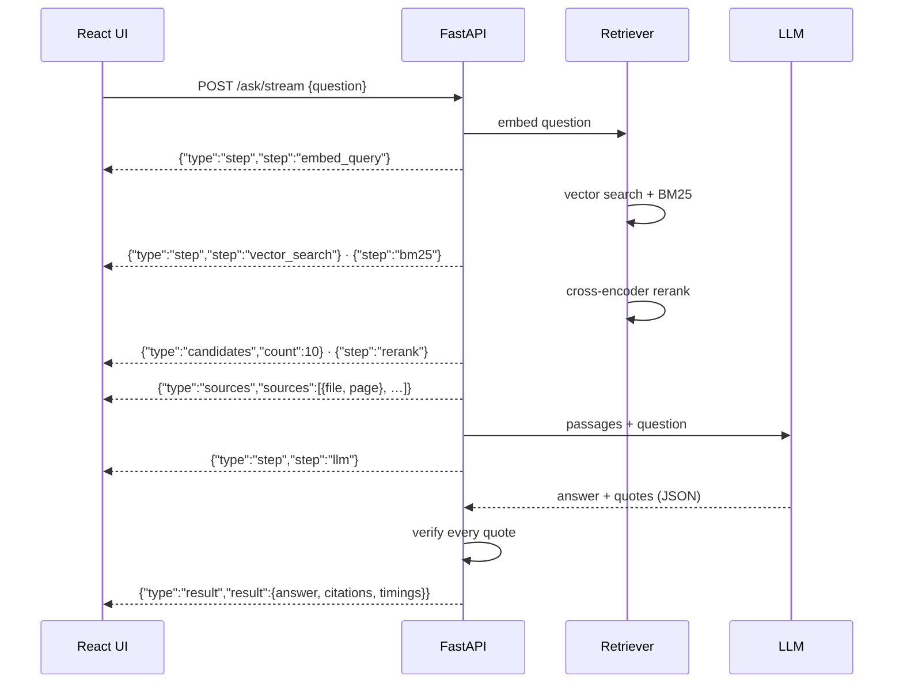
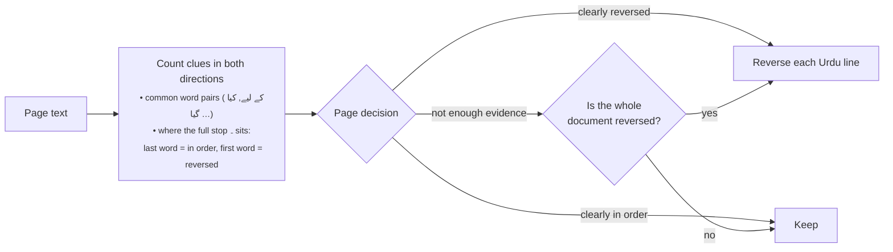

<p align="center">
  
</p>

<h1 align="center">Harf · حرف</h1>

<p align="center">
  <b>Question-answering over Urdu and English PDFs — typed or scanned — with page-level citations.</b><br>
  <sub>Python · FastAPI · React · ChromaDB · BM25 · bge-m3 · bge-reranker-v2-m3 · Tesseract · Gemini</sub>
</p>

---

Upload Urdu or English PDFs — including scanned books and InPage exports — and ask questions in either language, or a mix of both. Every answer comes with the **file, page and exact passage** it was taken from, every quote is checked against its source, and the system says *"not found"* instead of guessing.

<p align="center"></p>

## Contents

- [Features](#features)
- [Architecture](#architecture)
  - [Ingestion: how a document is read](#ingestion-how-a-document-is-read)
  - [Answering: how a question is answered](#answering-how-a-question-is-answered)
  - [Live progress over a stream](#live-progress-over-a-stream)
  - [Repairing reversed Urdu text](#repairing-reversed-urdu-text)
- [Quick start](#quick-start)
- [Setup in detail](#setup-in-detail)
- [The web app](#the-web-app)
- [API](#api)
- [Configuration](#configuration)
- [Evaluation](#evaluation)
- [Tests](#tests)
- [Privacy](#privacy)
- [Project layout](#project-layout)
- [Roadmap](#roadmap)

## Features

| | |
| --- | --- |
| 📄 **Any PDF** | Text-layer PDFs are read directly; scanned or broken pages go through Urdu OCR (Tesseract `urd+eng`, with a Gemini vision fallback for garbled pages) |
| 🔁 **Urdu text repair** | Fixes PDFs that store Urdu words in reverse order, mojibake, broken ligatures and letter variants (ی/ي, ک/ك, ہ/ه), and Urdu/Arabic digits |
| 🔎 **Hybrid retrieval** | Semantic search (bge-m3 + ChromaDB) and keyword search (BM25), merged with reciprocal rank fusion |
| 🎯 **Reranking** | A cross-encoder (bge-reranker-v2-m3) picks the strongest passages |
| 📌 **Grounded, cited answers** | The LLM answers only from retrieved passages; each quote is verified against its chunk, and every citation links to the original page image |
| 🌐 **Bilingual** | Ask in Urdu, English or a mix; the answer comes back in the language you asked in |
| ⚡ **Live progress** | `/ask/stream` streams each pipeline step, so the UI shows understanding → searching → ranking → writing as it happens, plus a per-stage timing breakdown |
| 🧪 **Measured** | An evaluation harness for the page classifier, OCR error rate, retrieval hit@5, citation accuracy and answer accuracy |

## Architecture

Two pipelines share one store. **Ingestion** runs once per document in the background; **answering** runs on every question.



Every chunk stays on one page, so each citation points at an exact page image.

### Ingestion: how a document is read



The page classifier ([app/ingestion/classifier.py](app/ingestion/classifier.py)) decides per page whether to trust the text layer. It catches empty pages, private-use glyphs, Latin-1 mojibake, broken ligature mappings, letters split apart, garbled words, and scans with a small typed header. OCR runs in a worker pool with retries, adaptive back-off on rate limits, and per-page status, so a failed page can be retried without redoing the document.

### Answering: how a question is answered



- **Hybrid search** finds passages by meaning *and* by exact words (names, numbers, legal terms), which matters for Urdu, where one word can be spelled several ways.
- **Reranking** reads each candidate against the question with a cross-encoder — slower than vector search, but much more precise.
- **Grounding:** the prompt allows only the retrieved passages. Each citation's quote is fuzzy-matched against its chunk; if any can't be matched, the answer is marked `grounded: false` and the UI warns the reader.
- **Not found:** when the best passage scores below `MIN_RELEVANCE_SCORE`, the system answers "not found" without calling the LLM at all.

### Live progress over a stream

`POST /ask/stream` returns newline-delimited JSON. The UI turns these events into a live checklist, a progress bar and the list of pages being read, then shows a per-stage timing waterfall on the finished answer.



### Repairing reversed Urdu text

Many PDF generators draw right-to-left text left-to-right, so the text layer holds each Urdu word correctly but each line's words in reverse — which silently breaks search. [app/processing/bidi.py](app/processing/bidi.py) detects and repairs it:



| Stored in the PDF | After repair |
| --- | --- |
| <div dir="rtl">گیا۔ رکھا پر نام کے والدہ کی بانی نام کا کمپنی</div> | <div dir="rtl">کمپنی کا نام بانی کی والدہ کے نام پر رکھا گیا۔</div> |

Pages with too little evidence of their own follow the rest of the document, since one PDF generator writes every page the same way.

## Quick start

```bash
make setup      # .venv with Python 3.12, dependencies, .env from the example
make doctor     # checks Python env, API key, Tesseract + Urdu, Docker
make dev        # backend on :8000 and the React UI on :5173 together (Ctrl+C stops both)
```

Then open <http://localhost:5173>, upload a PDF and ask a question.

`make` lists every task. Other common ones:

```bash
make backend    # FastAPI with auto-reload (API docs at http://localhost:8000/docs)
make web        # React UI dev server
make test       # all tests
make lint       # ruff format + fixes (make lint-check only reports, for CI)
make eval LABEL=baseline
```

It works from PowerShell or Git Bash on Windows (needs [GNU Make](https://community.chocolatey.org/packages/make) and Git for Windows) and on Linux and macOS.

## Setup in detail

### Windows, local

1. **Python 3.12.** Some dependencies (torch, chromadb) lag behind the newest Python, so use 3.12:
   ```powershell
   py -3.12 -m venv .venv
   .venv\Scripts\activate
   pip install torch --index-url https://download.pytorch.org/whl/cpu
   pip install -r requirements-dev.txt
   ```
2. **Tesseract with Urdu.** Install the [UB Mannheim build](https://github.com/UB-Mannheim/tesseract/wiki) and tick *Urdu* under additional languages, or drop `urd.traineddata` into `C:\Program Files\Tesseract-OCR\tessdata`. The [tessdata_best](https://github.com/tesseract-ocr/tessdata_best) model is slower but more accurate on Nastaliq. Check with `tesseract --list-langs`.
3. **Node.js 20+** for the React UI: `cd web && npm install`.
4. **Configuration.** Copy `.env.example` to `.env` and set `GEMINI_API_KEY` (and `TESSERACT_CMD` if Tesseract is not on PATH).
5. **Run:**
   ```powershell
   uvicorn app.main:app --reload     # API on http://localhost:8000, docs at /docs
   cd web; npm run dev               # UI on http://localhost:5173
   ```

The first upload downloads bge-m3 (~2.3 GB) and the first question downloads the reranker (~2.3 GB) into the Hugging Face cache; `PRELOAD_MODELS=true` loads both at startup. On a CPU, indexing takes a few seconds per text page, and Tesseract OCR roughly 5–15 seconds per scanned page.

### Docker

```bash
cp .env.example .env        # set GEMINI_API_KEY
docker compose up --build   # API :8000
```

The image includes Tesseract with the Urdu model. Models are cached in a named volume and data lives in `./storage`.

## The web app

A three-pane React + TypeScript app ([web/](web/)), built with Vite:

| Pane | What it shows |
| --- | --- |
| **Navigation** | Library filters (all, ready, processing, needs attention), the current search scope, and the system: answering model, OCR engine, pages indexed |
| **Documents** | Drag-and-drop upload, a filterable document table with status and per-page OCR progress, and a detail view of every page with its extraction method and OCR confidence |
| **Assistant** | Chat with Urdu-aware right-to-left text, live pipeline progress (with a stop button), cited answers with page-image previews, and a per-stage timing waterfall |

Selecting documents limits questions to them. Light and dark themes follow the system setting. On narrow screens the navigation becomes a drawer, and phones switch between documents and chat with tabs. A Streamlit prototype is still in [ui/](ui/) (`make dev-streamlit`).

## API

| Method | Path | Purpose |
| --- | --- | --- |
| POST | `/documents` | Upload a PDF (multipart `file`); returns the document id at once, processing runs in the background |
| GET | `/documents` | List documents with status (`uploaded`, `extracting`, `indexing`, `ready`, `failed`) and page progress |
| GET | `/documents/{id}` | One document with per-page method, classifier reason, OCR confidence and a low-confidence flag |
| GET | `/documents/{id}/pages/{n}/image` | Page image for citation previews |
| POST | `/documents/{id}/reprocess` | Redo failed, garbled or unfinished pages and rebuild the index. `?full=true` redoes every page |
| DELETE | `/documents/{id}` | Remove a document, its pages, chunks, vectors and files |
| POST | `/ask` | `{"question": "...", "document_ids": [1, 2]}` → answer, language, `found`, `grounded`, citations |
| POST | `/ask/stream` | Same request; streams progress events, then the answer (see [Live progress](#live-progress-over-a-stream)) |
| GET | `/health` | Service check, document counts, answering model and OCR engine |

An `/ask` response:

```json
{
  "answer": "ہر مستحق طالب علم کو ماہانہ 12,000 روپے وظیفہ ملے گا۔",
  "language": "ur",
  "found": true,
  "grounded": true,
  "citations": [{
    "document_id": 3, "filename": "welfare_policy_2025.pdf", "page_no": 4,
    "quote": "each eligible student will receive a monthly stipend of Rs. 12,000",
    "passage": "…full chunk text…", "quote_verified": true,
    "image_url": "/documents/3/pages/4/image"
  }],
  "latency_ms": 4210, "cached": false, "note": null,
  "timings": {"embed_query": 310, "vector_search": 40, "bm25": 12, "rerank": 2900, "llm": 930, "total": 4210}
}
```

`grounded` is false when a quote can't be matched to the chunk it cites; the UI then asks the reader to check the page. `timings` is included when `DEBUG_TIMINGS=true`.

## Configuration

All settings live in [app/config.py](app/config.py) and can be set in `.env`. The ones you will tune most:

| Setting | Default | Notes |
| --- | --- | --- |
| `LLM_PROVIDER` / `GEMINI_MODEL` | `gemini` / `gemini-2.5-flash` | Also `openai` or `anthropic` |
| `LLM_BACKUP_PROVIDER` | unset | e.g. `openai`: used only when the primary fails (quota, outage, bad output). `OPENAI_BASE_URL` points it at any OpenAI-compatible API |
| `OCR_ENGINE` | `tesseract` | `gemini`, `claude` and `docai` send page images to outside services |
| `OCR_FALLBACK_ENABLED` / `OCR_FALLBACK_ENGINE` | `true` / `gemini` | Re-read pages whose Tesseract output looks garbled. `false` never sends page images out |
| `OCR_MIN_URDU_SHARE` | `0.85` | Tesseract output with Urdu letters between 10% and this share counts as garbled |
| `OCR_CONCURRENCY` | `4` | Pages OCR'd at once; halved automatically while the OCR service returns 429 |
| `EMBEDDING_MODEL` | `BAAI/bge-m3` | e5 models get their `query:`/`passage:` prefixes automatically |
| `RERANKER_ENABLED` | `true` | The reranker is the slowest step on CPU (~1.5–2 s per candidate) |
| `CANDIDATE_K` | `20` | Passages the reranker scores; lower is faster on CPU |
| `FINAL_TOP_K` | `6` | Passages sent to the LLM |
| `MIN_RELEVANCE_SCORE` | unset | Below this top score, answer "not found" without calling the LLM |
| `CHUNK_SIZE` / `CHUNK_OVERLAP` | `800` / `150` | Characters |
| `PRELOAD_MODELS` | `true` | Load the embedder and reranker at startup so the first question is fast |
| `DEBUG_TIMINGS` | `false` | Add per-step timings to `/ask` responses (always logged) |
| `GEMINI_THINKING_BUDGET` | `0` | `0` is fastest; `-1` lets Gemini think |
| `LOW_CONFIDENCE_THRESHOLD` | `0.6` | OCR pages below this are flagged |

## Evaluation

Each change is judged against one fixed test set. The scripts index `eval/documents` into a separate store (`eval/.storage`), so experiments never touch the app's data.

1. Put 15–20 real PDFs (typed, scanned, InPage-exported, mixed) in `eval/documents/`.
2. Copy `eval/questions.example.jsonl` to `eval/questions.jsonl` and write about 50 questions: half Urdu, half English, and about 10 with `"answerable": false`.
3. Run the gates:

| Gate | Command |
| --- | --- |
| Classifier right on 95% of pages | `python -m eval.classify_report` (label pages in `eval/page_labels.csv`) |
| Baseline scores recorded | `python -m eval.run_eval --label baseline` |
| OCR error rate under 10% | `python -m eval.ocr_compare render eval/documents/x.pdf 2 5`, type the references, then `python -m eval.ocr_compare run --engines tesseract,gemini,docai` |
| Answer accuracy over 80% | `python -m eval.run_eval --label <experiment>` |

Comparing models is cheap: retrieval-only runs skip the LLM, and switching embedding models re-embeds stored chunks without re-running OCR.

```bash
python -m eval.run_eval --label bge-m3 --retrieval-only
python -m eval.run_eval --label e5-large --retrieval-only --embedding-model intfloat/multilingual-e5-large
python -m eval.run_eval --label no-rerank --no-reranker
```

Every run appends a row to `eval/results/log.csv` and writes per-question detail next to it. Answer accuracy is graded by an LLM judge against your reference answer; retrieval hit@5, citation accuracy and not-found accuracy are computed directly.

## Tests

```bash
pytest
```

The tests replace the embedder, reranker, OCR engine and LLM with fakes. They cover the full path — upload → classify → OCR → repair → chunk → index → ask (plain and streamed) → cite → delete — without downloading models or calling an API.

## Privacy

Tesseract and the embedding and reranking models run locally. Only retrieved passages, never whole documents, are sent to the configured LLM API to write answers. Choosing `OCR_ENGINE=gemini`, `claude` or `docai`, or enabling the Gemini OCR fallback, also sends page images out. Add access control before any shared deployment.

## Project layout

| Path | What it does |
| --- | --- |
| [app/ingestion/](app/ingestion/) | Pipeline, page classifier, OCR engines (Tesseract, Gemini, Claude, Document AI), retries |
| [app/processing/](app/processing/) | Word-order repair, normalization, header/footer cleanup, chunking, language detection |
| [app/retrieval/](app/retrieval/) | bge-m3 embeddings, ChromaDB, BM25, rank fusion, reranker, step timings and progress events |
| [app/generation/](app/generation/) | Sources-only prompt, LLM providers with JSON output, citation verification, answer cache |
| [app/api/](app/api/) | FastAPI routes, including the streaming `/ask/stream` |
| [web/](web/) | React + TypeScript UI |
| [ui/](ui/) | Streamlit prototype |
| [eval/](eval/) | Test-set runner, OCR comparison, classifier report |
| [scripts/inspect_store.py](scripts/inspect_store.py) | Inspect stored documents, chunks and vectors; run nearest-chunk searches |
| [Project Plan/](Project%20Plan/) | The original project plan |

## Roadmap

- **Built:** ingestion with OCR and Urdu text repair, hybrid retrieval and reranking, grounded answers with citation checks, not-found handling, streaming progress, the React UI, and the evaluation tooling.
- **Next:** measured results on a public test set in this README, faster reranking on CPU (ONNX / quantized models), and deployment.
- **Later:** chat history, user accounts and roles, feedback buttons.

---

<p align="center">Built by <b>Usman Zafar</b> · <a href="https://www.linkedin.com/in/immusmz">LinkedIn</a></p>
